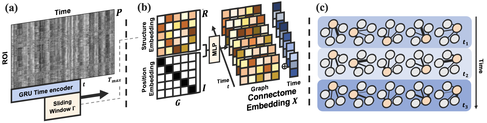
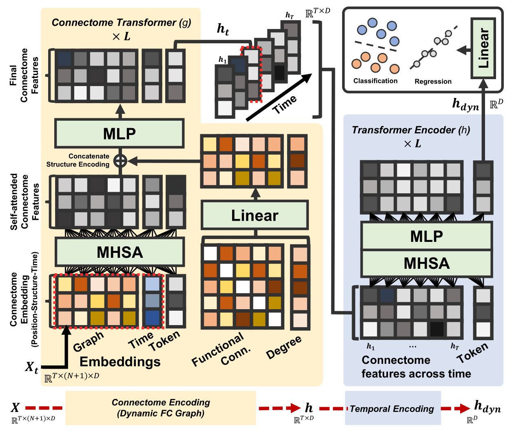

# TeNeT: Temporal Neural Transformer

Official implementation of **TeNeT**, a graph Transformer for learning dynamic functional connectivity (FC) from resting-state fMRI.

> **Learning Dynamic Brain Connectome with Graph Transformers for Psychiatric Diagnosis Classification**<br>
> Byung-Hoon Kim\*, Jungwon Choi\*, EungGu Yun, Kyungsang Kim, Xiang Li, Juho Lee<br>
> *IEEE International Symposium on Biomedical Imaging (ISBI) 2024, Oral* · [Paper](https://ieeexplore.ieee.org/document/10635508)

> **Large-scale Graph Representation Learning of Dynamic Brain Connectome with Transformers**<br>
> *Temporal Graph Learning Workshop @ NeurIPS 2023* · [Paper](https://openreview.net/forum?id=WvFHDkIhmp)

<p align="center">
    
</p>
<p align="center">
    
</p>

For each sliding window *t*, TeNeT builds a **connectome embedding** *X<sub>t</sub>* that combines
- **structure**: the windowed correlation matrix *R<sub>t</sub>* without self-loops,
- **position**: the one-hot encoding of each ROI, and
- **time**: a GRU encoding of the ROI time series up to the end of the window.

A graph Transformer attends across ROIs within each window, and a second Transformer attends across windows to produce the subject representation used for classification or regression.

## Installation

```bash
pip install torch==2.2.0 --index-url https://download.pytorch.org/whl/cu121
pip install -r requirements.txt
```

## Data

Place the ROI time series and phenotype table of each dataset under `data/`:

```
data/
└── hcpep-rest/
    ├── hcpep-rest_roi-schaefer400.pkl   # dict {subject_id: ndarray [T, N]}
    └── hcpep-rest.csv                   # 'subject_id' column + target columns
```

- **Time series**: mean BOLD signal within each ROI of the Schaefer atlas (400 ROIs in the paper), one array of shape `[time points, ROIs]` per subject. Each ROI is z-scored per subject when loaded.
- **Phenotype table**: one row per subject with a `subject_id` column and the target column named in the config (e.g., `sex`, `interview_age`, `phenotype`).

The paper uses the following datasets (subjects after preprocessing; diagnosis as patients / controls):

| Dataset | Name | Subjects | Diagnosis (P / C) | Configs |
|---|---|---|---|---|
| [UK Biobank](https://www.ukbiobank.ac.uk/) | `ukb-rest` | 40,913 | – | gender, age |
| [ABCD](https://abcdstudy.org/) | `abcd-rest` | 9,111 | – | gender |
| [HCP-YA](https://www.humanconnectome.org/study/hcp-young-adult) | `hcp-rest` | 1,093 | – | gender |
| [HCP-D](https://www.humanconnectome.org/study/hcp-lifespan-development) | `hcpd-rest` | 632 | – | gender, age |
| [HCP-A](https://www.humanconnectome.org/study/hcp-lifespan-aging) | `hcpa-rest` | 723 | – | gender, age |
| [HCP-EP](https://www.humanconnectome.org/study/human-connectome-project-for-early-psychosis) | `hcpep-rest` | 176 | 120 / 56 | gender, age, dx |
| [ABIDE](http://fcon_1000.projects.nitrc.org/indi/abide) | `abide-rest` | 884 | 408 / 476 | gender, age, dx |
| [ADHD200](https://fcon_1000.projects.nitrc.org/indi/adhd200) | `adhd200-rest` | 669 | 280 / 389 | gender, age, dx |
| [UCLA](https://openneuro.org/datasets/ds000030) | `ucla-rest` | 265 | 140 / 125 | gender, age, dx (multi-class) |
| [COBRE](https://fcon_1000.projects.nitrc.org/indi/retro/cobre.html) | `cobre-rest` | 173 | 89 / 84 | gender, age, dx (multi-class) |

Access to each dataset follows its own data use agreement. For UK Biobank, downstream evaluation uses a fixed 10% subset of subjects.

## Training and evaluation

Each config in `configs/` is named `<dataset>_<task>.yaml` (task: `gender`, `age`, or `dx`) and inherits shared settings from `configs/default.yaml`.

```bash
# 5-fold cross-validation on a single GPU
python train.py --config configs/hcpep_dx.yaml --data_dir ./data --output_dir ./result/hcpep_dx

# selected folds only
python train.py --config configs/hcpep_dx.yaml --data_dir ./data --output_dir ./result/hcpep_dx --folds 0 1

# multiple GPUs (minibatch_size is split across GPUs)
torchrun --nproc_per_node 2 train.py --config configs/hcpep_dx.yaml --data_dir ./data --output_dir ./result/hcpep_dx
```

Any config value can be overridden from the command line, e.g. `--lr 1e-5 --minibatch_size 8`.

Outputs in `--output_dir`:
- `fold<k>/train_log.jsonl`: training and test metrics per evaluated epoch
- `fold<k>/model.pth`, `fold<k>/test_predictions.npz`, `fold<k>/test_metrics.json`
- `results.csv`: test metrics of every fold with mean and standard deviation

Classification reports AUROC (macro one-vs-rest for multi-class), accuracy, balanced accuracy, precision, recall, and F1; regression reports R², MSE, and MAE.

### Settings used in the paper

| | |
|---|---|
| Model | hidden size 1024, 4 graph Transformer layers, 4 temporal Transformer layers, 4 heads |
| Optimization | Adam with one-cycle schedule, batch size 4, learning rate 5e-6 (searched over {2, 4, 6, 8} and {5e-4 … 1e-7}) |
| Epochs | 15 for UK Biobank and ABCD, 30 otherwise |
| Sliding window (size / stride / length) | 50 / 16 / dataset-specific for UKB, ABCD, and HCP; 16 / 3 / dataset-specific for ABIDE, ADHD200, UCLA, and COBRE |

During training, a random segment of `dynamic_length` time points is cropped from each subject; at test time the windows are taken from the first `dynamic_length` time points. FC values are Fisher z-transformed and clipped to [-5, 5] before the embedding.

## Citation

```bibtex
@inproceedings{kim2024learning,
  title        = {Learning dynamic brain connectome with graph transformers for psychiatric diagnosis classification},
  author       = {Kim, Byung-Hoon and Choi, Jungwon and Yun, EungGu and Kim, Kyungsang and Li, Xiang and Lee, Juho},
  booktitle    = {2024 IEEE International Symposium on Biomedical Imaging (ISBI)},
  pages        = {1--5},
  year         = {2024},
  organization = {IEEE}
}

@inproceedings{kim2023large,
  title     = {Large-scale Graph Representation Learning of Dynamic Brain Connectome with Transformers},
  author    = {Kim, Byung-Hoon and Choi, Jungwon and Yun, EungGu and Kim, Kyungsang and Li, Xiang and Lee, Juho},
  booktitle = {Temporal Graph Learning Workshop (NeurIPS 2023)},
  year      = {2023}
}
```

## License

This project is released under the GNU General Public License v3.0.
